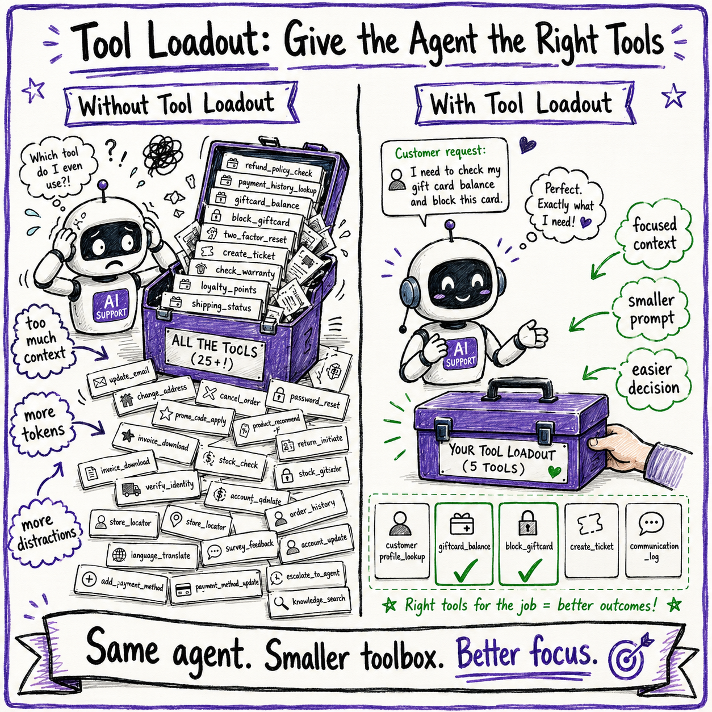
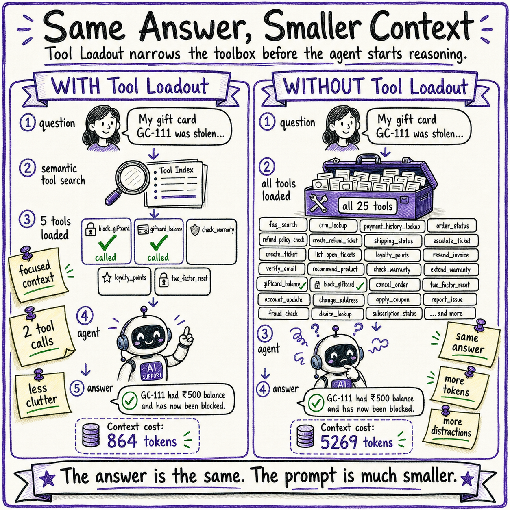

# Customer Support Agent Tool Loadout

A demonstration of **Context Engineering** using Tool Loadout to dynamically select relevant tools for an AI agent based on user queries, rather than loading all available tools at once.



## Overview

This project showcases how to build an intelligent customer support agent that uses semantic search to select only the most relevant tools for each customer query. Instead of providing the agent with all 25 tools (which can lead to confusion and slower responses), the system uses vector embeddings to identify the top-5 most relevant tools based on the user's request.

The agent can handle various customer support scenarios including:
- Order management and tracking
- Payment and refund processing
- Shipping and address updates
- CRM operations
- Ticket management
- Loyalty programs
- Warranty checks
- Security operations
- And more...

## Key Concepts Covered

- **Context Engineering**: Selecting relevant context (tools) dynamically based on user queries
- **Tool Loadout Pattern**: Dynamically loading only necessary tools for each request
- **Retrieval Augmented Generation (RAG)**: Using vector embeddings to retrieve relevant tools
- **Semantic Search**: Finding tools based on meaning rather than exact keyword matching
- **LangChain Agents**: Building intelligent agents with tool-calling capabilities
- **Vector Stores**: Using ChromaDB for efficient similarity search

## What You'll Learn

By working through this project, you'll learn:

1. **How to build a tool catalog** with descriptions that can be semantically searched
2. **Vector embedding techniques** for tool selection using OpenAI embeddings
3. **RAG implementation** for context-aware tool retrieval
4. **LangChain agent construction** with dynamic tool loading
5. **Performance optimization** by reducing tool bloat through selective loading
6. **Best practices** for context engineering in production AI systems

## Setup Instructions

### Prerequisites

- Python 3.12 or higher
- [uv](https://docs.astral.sh/uv/) (package & environment manager) — install with `curl -LsSf https://astral.sh/uv/install.sh | sh`
- OpenAI API key ([Get one here](https://platform.openai.com/api-keys))
- Git (optional, for cloning)

### Setup OpenAI API Key

1. **Get your API key** from [OpenAI Platform](https://platform.openai.com/api-keys)

2. **Create a `.env` file** in the project root directory:

```bash
# On macOS/Linux
touch .env

# On Windows
type nul > .env
```

3. **Add your API key** to the `.env` file:

```env
OPENAI_API_KEY=your_api_key_here
```

**Optional environment variables** (with defaults):

```env
OPENAI_API_KEY=your_api_key_here
LLM_MODEL=gpt-4o
LLM_TEMPERATURE=0
EMBEDDING_MODEL=text-embedding-3-small
PERSIST_DIR=.chroma_tools
RETURN_POLICY_DAYS=30

# Optional: LangSmith tracing
LANGCHAIN_TRACING_V2=false
LANGCHAIN_API_KEY=your_langsmith_key
LANGCHAIN_PROJECT=context-engineering-demo
```

## Install Dependencies

`uv` reads `pyproject.toml` and the pinned `uv.lock`, creating an isolated `.venv` for you:

```bash
uv sync
```

Key dependencies (LangChain 1.0 ecosystem):
- `langchain` (>=1.0) - agents via `create_agent`
- `langchain-core` (>=1.0) - base types (tools, messages)
- `langchain-openai` - OpenAI chat model + embeddings
- `langchain-chroma` - Chroma vector store integration (dedicated package)
- `langgraph` (>=1.0) - runtime that powers `create_agent`
- `langsmith` - optional tracing
- `pydantic`, `python-dotenv`, `rich` - data models, env loading, logging
- `ipykernel` - Jupyter notebook support

To add or change a dependency later, use `uv add <package>` / `uv remove <package>` (never edit the lockfile by hand).

## Project Structure

```
Customer_Support_Agent_Tool_Loadout/
├── data/
│   └── mock_stores.py      # Mock data stores for tools
├── rag/
│   └── indexer.py          # Tool indexing and vector store creation
├── tools/                  # Tool implementations
│   ├── __init__.py         # Tool catalog definition (25 tools)
│   ├── crm.py              # CRM operations
│   ├── faq.py              # FAQ search
│   ├── giftcards.py        # Gift card operations
│   ├── loyalty.py          # Loyalty program tools
│   ├── orders.py           # Order management
│   ├── payments.py         # Payment operations
│   ├── recommendations.py  # Product recommendations
│   ├── refunds.py          # Refund processing
│   ├── security.py         # Security operations
│   ├── shipping.py         # Shipping management
│   ├── tickets.py          # Ticket management
│   └── warranty.py         # Warranty operations
├── utils/
│   ├── embeddings.py       # Embedding model setup
│   └── logging.py          # Logging configuration
├── images/                 # Diagrams used in this README
├── app.ipynb              # Main notebook (agent + loadout demo lives here)
├── config.py              # Configuration management
├── pyproject.toml         # Project metadata & dependencies (uv)
├── uv.lock                # Pinned, reproducible dependency lockfile
└── README.md              # This file
```

> Note: the agent-building logic now lives directly in `app.ipynb` (the former `agent/builder.py` was inlined so the notebook is self-contained).

## Usage

The full walkthrough lives in `app.ipynb`. Launch it with uv (no manual venv activation needed):

```bash
uv run jupyter notebook app.ipynb
```

Run the cells top to bottom. The notebook will:
1. Build the tool index (embeds all 25 tool descriptions into Chroma)
2. Define the agent (`build_agent`) and the request handler (`service_request`)
3. Run the same refund query **with** Tool Loadout (top-5 tools) and **without** (all tools), so you can compare
4. Print an **intent table** showing how loadout selects a different toolset for each kind of query

### The core API

`service_request` is the entry point defined in the notebook:

```python
# With tool loadout (recommended): semantic search picks the top-5 tools
payload = service_request(
    user_query="I think I was charged twice for order A1099 and want a refund. My user id is user_123.",
    user_id="user_123",
    tool_loadout=True,
)
report_run("WITH tool loadout", payload)

# Without tool loadout: the agent gets all 25 tools
payload = service_request(
    user_query="Check my order status",
    user_id="user_123",
    tool_loadout=False,
)
```

## How It Works

### 1. Tool Indexing (Initial Setup)

When the application starts, it builds a vector index of all available tools:

```python
# Each tool has a name and description
ToolCard("refund_policy_check", "Check return eligibility window by delivery_date.", refund_policy_check)
ToolCard("order_status", "Get fulfillment & delivery details for order_id.", order_status)
# ... 25 tools total
```

These tool descriptions are embedded using OpenAI's embedding model and stored in ChromaDB.

### 2. Query Processing

When a user query arrives:

1. **Semantic Search**: The user query is embedded and compared against all tool descriptions
2. **Top-K Retrieval**: The system retrieves the top-5 most semantically similar tools
3. **Tool Selection**: Only the selected tools are loaded into the agent
4. **Agent Execution**: The agent processes the query using only the relevant tools

### 3. Example Flow


Tool Loadout narrows the menu, but the agent still chooses what to call: the top-5 search returns the relevant tools, and the agent invokes only the ones it actually needs (e.g. `giftcard_balance` then `block_giftcard`).

**User Query**: "I was charged twice for order A1099 and want a refund"

**Tool Selection Process**:
1. Query is embedded: `[0.123, -0.456, ...]`
2. Vector search finds similar tools:
   - `payment_history_lookup` (high similarity)
   - `refund_policy_check` (high similarity)
   - `create_refund_ticket` (high similarity)
   - `order_status` (medium similarity)
   - `crm_lookup` (medium similarity)
3. Agent is built with only these 5 tools
4. Agent processes query and calls relevant tools
5. Response is returned to user

### 4. Benefits of Tool Loadout



Same question, same answer — but the prompt is dramatically smaller. Loading only the relevant 5 tools instead of all 25 cuts the tool-description context from thousands of tokens to a few hundred.

- **Faster Responses**: Agent doesn't need to consider irrelevant tools
- **Better Accuracy**: Reduced confusion from too many tool options
- **Cost Efficiency**: Fewer tokens used in tool descriptions
- **Scalability**: Can handle hundreds of tools without performance degradation

## Notes

### Performance Considerations

- **First Run**: The initial tool indexing may take a few seconds as embeddings are generated
- **Subsequent Runs**: ChromaDB persists the index, so subsequent runs are faster
- **Vector Store Location**: By default, the index is stored in `.chroma_tools/` directory

### Tool Catalog

The project includes 25 tools covering various customer support scenarios. Each tool is defined with:
- **Name**: Unique identifier
- **Description**: Natural language description used for semantic search
- **Handle**: The actual LangChain tool implementation

### Customization

- **Add New Tools**: Add tool implementations in `tools/` directory and register them in `tools/__init__.py`
- **Adjust Tool Selection**: Modify the `TOP_K` constant in `app.ipynb` (currently set to 5)
- **Change Models**: Update environment variables in `.env` file

### Limitations

- This is a demonstration project with mock data stores
- Tools return simulated responses (see `data/mock_stores.py`)
- Production implementation would require real API integrations


