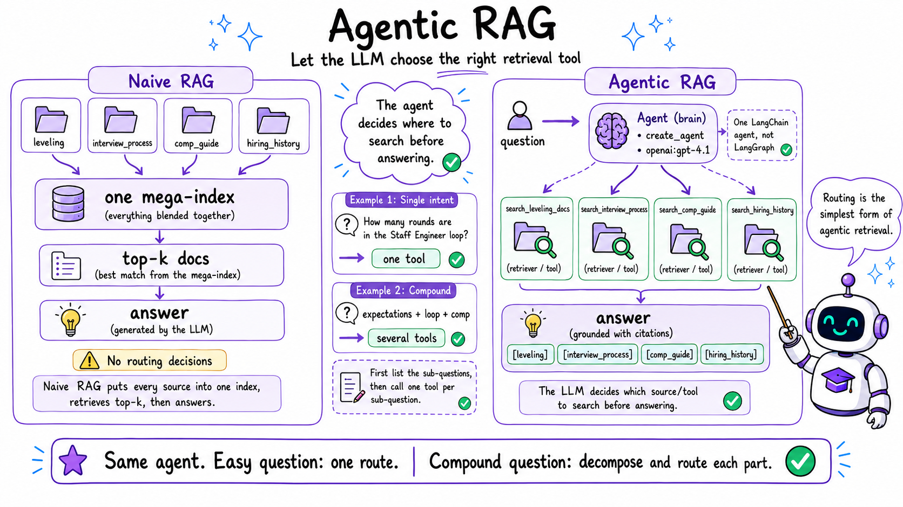

# Agentic RAG

A hands-on tutorial showing how an LLM agent can **decide** about retrieval — instead of blindly dumping every source into one index and answering from top-k (naive RAG).

The core idea: give the agent **four separate hiring corpora as four tools**, and let it act as a **router**. From that single setup, two behaviors emerge in the *same* agent:

1. **Routing** — a single-intent question → the agent calls exactly one tool.
2. **Decomposition** — a compound question → the agent splits it and calls several tools.

The whole system is **one `create_agent`** (LangChain 1.0). No LangGraph, no hand-wired graph.



## The four spokes

The dataset is a fictional engineering hiring knowledge base, split into four distinct corpora. Each becomes its own vector index and its own tool.

| Source | Tool | Contents |
|---|---|---|
| `leveling` | `search_leveling_docs` | Level rubrics, role expectations per IC level |
| `interview_process` | `search_interview_process` | Interview loops, rounds, scorecards |
| `comp_guide` | `search_comp_guide` | Salary bands, tier/YoE adjustments |
| `hiring_history` | `search_hiring_history` | Past offers, precedent |

Separate indexes (not one mega-index) are what *make routing possible* — the agent can target one corpus instead of fishing in a blended one, and citations stay clean.

## How it works

The tutorial walks through four steps:

1. **Build the four spokes** — load the markdown files under [data/](data/), chunk them with `RecursiveCharacterTextSplitter`, and embed each corpus into its own Chroma collection.
2. **Wrap each spoke as a tool** — the docstring *is* the prompt. It's the only thing the agent reads to decide which tool fits a sub-question, so it spells out *what's inside* and *when to use it*.
3. **The agent** — a single `create_agent` whose system prompt includes a decomposition nudge: *first list the sub-questions, then call one tool per sub-question.* This gives the agent **global** planning (commit to all parts before retrieving) instead of greedy planning — without a separate planner node.
4. **Demos** — a tracer prints the agent's full timeline (PLAN → TOOL CALLS → EVIDENCE → ANSWER) so routing and decomposition become visible rather than abstract.

## Project layout

```
agentic_rag/
├── agentic_rag_tutorial.ipynb   # the tutorial notebook (start here)
├── data/                        # the four hiring corpora (markdown)
│   ├── leveling/
│   ├── interview_process/
│   ├── comp_guide/
│   └── hiring_history/
├── images/                      # diagrams used in the notebook
├── pyproject.toml               # dependencies
├── .env.demo                    # template for required env vars
└── README.md
```

## Setup

Requires **Python 3.12+** and an **OpenAI API key** (used for `text-embedding-3-small` embeddings and the `gpt-4.1` agent model).

This project uses [uv](https://docs.astral.sh/uv/) for dependency management.

```bash
# 1. Install dependencies into a virtual environment
uv sync

# 2. Configure your API key
cp .env.demo .env
# then edit .env and set OPENAI_API_KEY to your real key
```

## Running the tutorial

Open the notebook and run the cells top to bottom:

```bash
uv run jupyter lab agentic_rag_tutorial.ipynb
```

Or select the project's `.venv` as the kernel in VS Code / Jupyter and run [agentic_rag_tutorial.ipynb](agentic_rag_tutorial.ipynb).

The notebook builds the retrievers, defines the agent, then runs:

- **Demo A — Routing:** single-intent questions that each route to exactly one tool.
- **Demo B — Decomposition:** a messy, four-part question that the agent splits and routes part-by-part — same agent, no code changes.

## Key takeaways

- **Agentic RAG = the LLM decides about retrieval.** Here the decision is *which source* → routing.
- **One `create_agent` + N well-described tools** is the entire system. The docstrings are the routing logic.
- **Decomposition isn't a separate step** — it's routing applied to each part of a compound question, emerging from the same ReAct loop.
- **The decomposition nudge** ("list the parts, then one tool per part" in the prompt) buys reliable global planning without building a planner node or touching LangGraph.

**Where you'd reach for more:** if you need a *strict* "is this evidence sufficient? retrieve again" check with a bounded retry, that's self-correction — the ReAct loop does it only loosely. That's the natural motivation for graduating to LangGraph in a follow-up.

> **Note on citations:** with a single agent, citation accuracy rests on the prompt asking the model to tag claims by source — there's no separate provenance-tracking step. Good enough for a tutorial; tighten it if you ship this.
