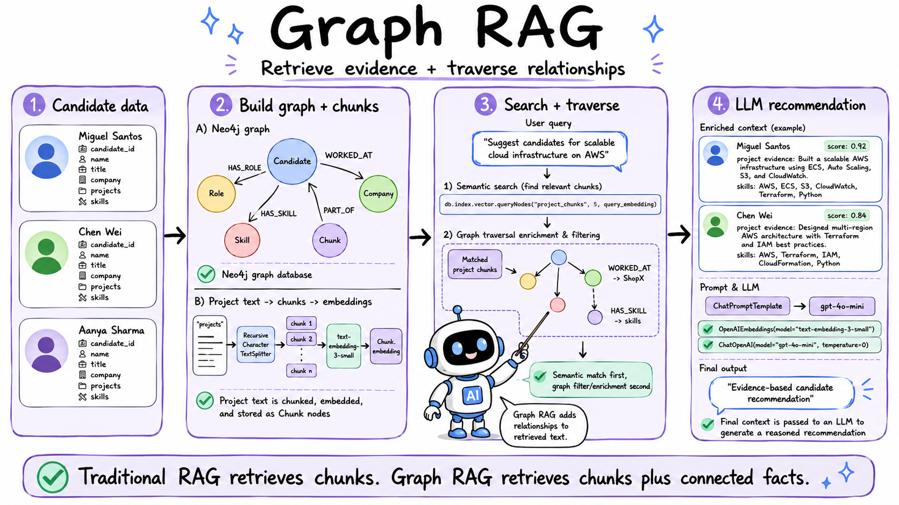
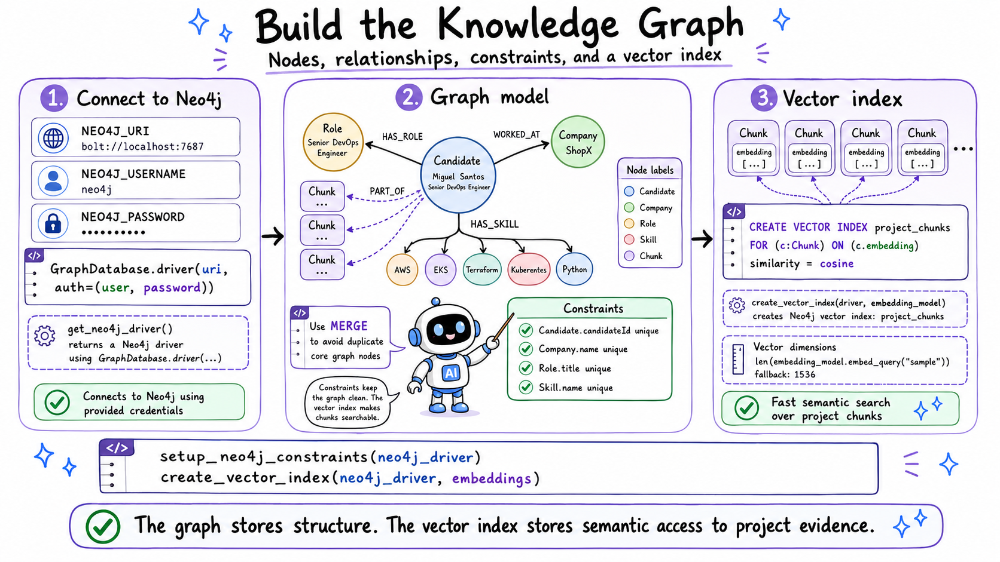
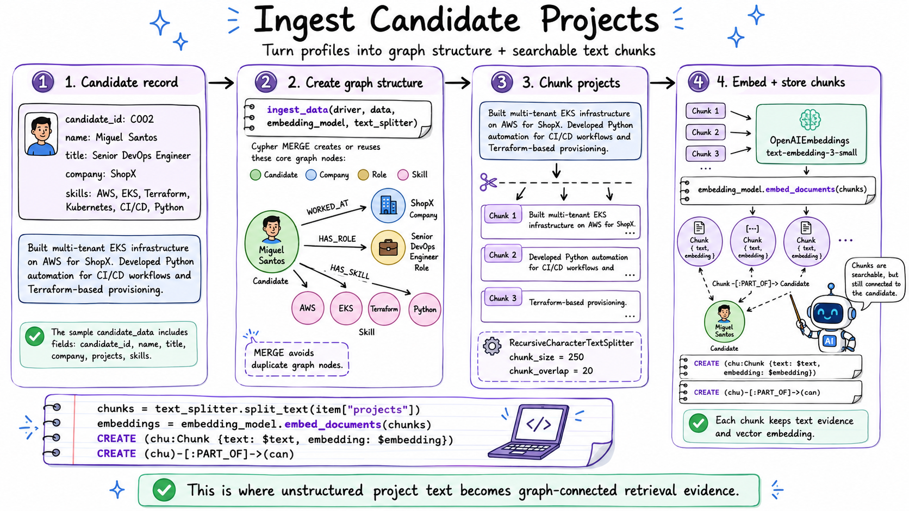
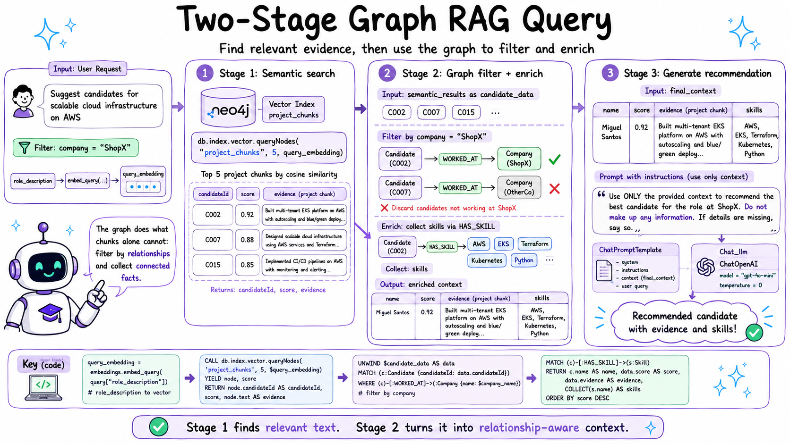

# Building a Recruitment Co-pilot with GraphRAG

A hands-on tutorial for **Week 2 · Session 2**. You'll build a candidate-recommendation
system that combines **semantic search** with **graph traversal** — i.e. GraphRAG.

Traditional RAG retrieves disconnected chunks of text from a vector store. GraphRAG
goes further: it retrieves from a **knowledge graph**, so you leverage not just the
content of the text but also the rich relationships between entities.

The system recommends job candidates by:

1. **Semantic search** over project descriptions to find relevant experience.
2. **Graph enrichment** — traversing the knowledge graph to gather structured data like
   skills and work history.
3. **Filtering** on structured criteria (e.g. candidates who worked at a specific company).
4. **Synthesis** — passing the combined context to an LLM for a reasoned, evidence-based
   recommendation.



## Tech Stack

- **Neo4j** (Aura cloud) — graph database with a native vector index
- **OpenAI** — `text-embedding-3-small` for embeddings, `gpt-4o-mini` for generation
- **LangChain** — text splitting and chat model interface
- **Python 3.12+**

## Setup

### 1. Create and activate a virtual environment

```bash
# Create virtual environment
python3 -m venv .venv

# Mac/Linux: activate
source .venv/bin/activate

# Windows: activate
.venv\Scripts\activate
```

### 2. Install packages

```bash
pip install -r requirements.txt
```

> Alternatively, this repo is set up for [`uv`](https://docs.astral.sh/uv/)
> (see `pyproject.toml` / `uv.lock`): just run `uv sync`.

### 3. Configure credentials

Copy the example env file and fill in your own values:

```bash
cp .env.demo .env
```

Then edit `.env`:

```bash
# OpenAI — used by ChatOpenAI and OpenAIEmbeddings
OPENAI_API_KEY=sk-proj-...

# Neo4j connection (e.g. a free Neo4j Aura instance)
NEO4J_URI=neo4j+s://xxxxxxxx.databases.neo4j.io
NEO4J_USERNAME=neo4j
NEO4J_PASSWORD=changeme
```

A free graph database is available at [Neo4j Aura](https://neo4j.com/cloud/aura/).

### 4. Run the notebook

Open `graph_rag.ipynb` in Jupyter or VS Code and run the cells top to bottom.

## How It Works

### Data model

We model the recruitment domain as a graph:

- **Nodes:** `Candidate`, `Company`, `Role`, `Skill`, `Chunk`
- **Relationships:** `(Candidate)-[:WORKED_AT]->(Company)`,
  `(Candidate)-[:HAS_ROLE]->(Role)`, `(Candidate)-[:HAS_SKILL]->(Skill)`,
  `(Chunk)-[:PART_OF]->(Candidate)`

Unstructured project descriptions are split into `Chunk` nodes, embedded, and stored
with a vector index (`project_chunks`) for similarity search.

### Build the graph (ingestion — run once)



`setup_neo4j_constraints()` adds uniqueness constraints (preventing duplicate nodes),
then `ingest_data()`:

1. **MERGE**s the base graph (candidates, companies, roles, skills + relationships).
2. **Chunks and embeds** each candidate's project text.
3. **Stores** chunks with their embeddings, linked back to the candidate.

Finally `create_vector_index()` builds the `project_chunks` vector index.



### Query the graph (retrieval + generation)



1. **Semantic search** — embed the role description and use
   `db.index.vector.queryNodes` to find the top-matching project chunks.
2. **Filter + augment** — traverse the graph to keep only candidates who match the
   structured filter (e.g. `WORKED_AT` a given company) and collect their skills.
3. **Generate** — pass the enriched context to the LLM, which returns an
   evidence-based recommendation citing the specific project work.

## Files

| File | Description |
|------|-------------|
| `graph_rag.ipynb` | The main tutorial notebook |
| `requirements.txt` | Python dependencies (pip) |
| `pyproject.toml` / `uv.lock` | Dependencies for `uv` |
| `.env.demo` | Example environment file — copy to `.env` |
| `images/` | Architecture diagrams referenced in the notebook |
